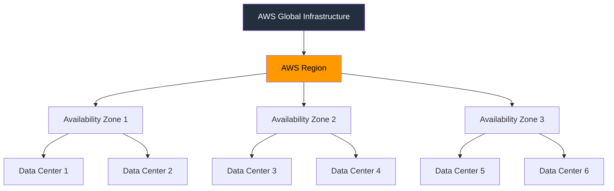

## Định Nghĩa 
AWS Region là một khu vực địa lí trên thế giới mà AWS xây dựng các cơ sở hạ tầng để cung cấp dịch vụ điện toán đám mây, đây cũng là những nơi mà người dùng chọn để đặt tài nguyên cloud của họ lên (như máy ảo, database, ...)

## Các Thành Phần
AWS Region gồm nhiều [[AZ - Availability Zone]] và mỗi AZ lại gồm nhiều data center 

## Đặc Điểm
- việc sao chép dữ liệu giữa các region phải được thực hiện bởi người dùng (dùng để backup, khôi phục, ... khi)

## Cách Chọn Region 
các yếu tố ảnh hưởng đến việc chọn region phù hợp:
- quản trị dữ liệu và các yêu cầu pháp lí: do một số quốc gia yêu cầu dữ liệu thuộc về quốc gia đó không được truyền ra ngoài và các vấn đề khác 
- Khoàng cách tới người dùng: region mà bạn chọn nên có khoảng cách gần đối với khách hàng bạn nhắm tới (để giảm độ trễ)
- Các dịch vụ AWS có trong region: không phải region nào cũng cung cấp tất cả dịch vụ mà AWS cung cấp 
- Giá cả: mỗi region sẽ có mức giá cho các dịch vụ khác nhau 