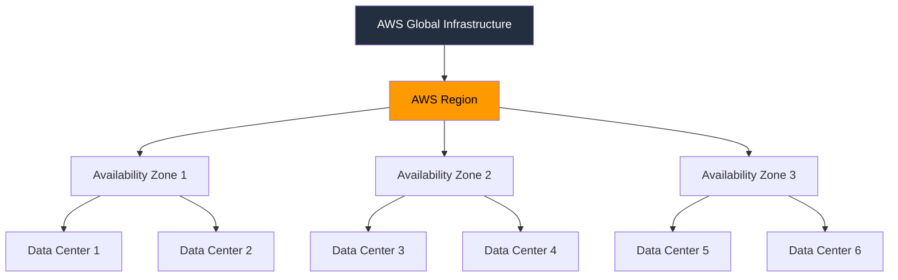

## Định Nghĩa 
AWS Region là một khu vực địa lí trên thế giới mà AWS xây dựng các cơ sở hạ tầng để cung cấp dịch vụ điện toán đám mây, đây cũng là những nơi mà người dùng chọn để đặt tài nguyên cloud của họ lên (như máy ảo, database, ...)

## Các Thành Phần
AWS Region gồm nhiều [[AZ - Availability Zone]] và mỗi AZ lại gồm nhiều data center 

## Đặc Điểm
- việc sao chép dữ liệu giữa các region phải được thực hiện bởi người dùng 